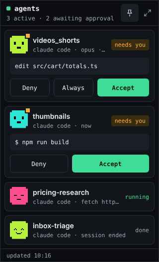
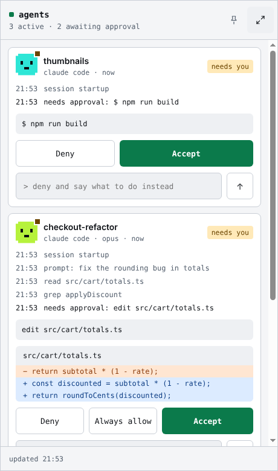

# Agent Monitor Widget

A small tray app that shows what each of your Claude Code sessions is doing, and lets you accept or deny their permission requests without switching back to the terminal.

<p>
  
  
</p>

*Screenshots use sample sessions.*

## What it does

- **One card per session.** Each Claude Code session gets a card with its project folder, model, status and latest action.
- **Approve from the widget.** When a session asks for permission to edit a file or run a command, the card shows the request with **Accept**, **Deny** and (when Claude Code offers a rule) **Always allow**.
- **Expanded view.** Shows a short activity log per session, a preview of the proposed edit, and a box to deny with a message telling Claude what to do instead.
- **Floats above your windows.** The widget stays on top of other windows, on every desktop/Space. Drag it by its header to move it. Turn off the pin button to make it hide when you click away instead.
- **Sizes itself.** It is small when empty and grows as sessions are added, up to 720px tall, then scrolls.
- **Tray icon.** Green when nothing is waiting, amber when a session needs you. A desktop notification appears when a request arrives while the widget is hidden.
- **Dark and light.** Follows your system theme.
- **Pixel avatars.** Each session gets its own colour. The avatar hops while the session waits on you and bobs while it works.

## Requirements

- [Node.js](https://nodejs.org) 20 or newer
- [Claude Code](https://code.claude.com), a version that supports `http` hooks
- `curl` on your PATH (included with macOS, Windows 10+ and most Linux systems)

## Quick start

```bash
git clone https://github.com/sakshi7xix/agent-monitor-widget.git
cd agent-monitor-widget
npm install

# 1. Tell Claude Code to send activity to the widget
npm run install-hooks

# 2. Start the tray app
npm start
```

Then start (or restart) a Claude Code session. Sessions that were already running keep their old settings until you restart them.

The widget opens when the app starts. Click the tray icon to hide or show it. Right-click the icon for the menu, which can add or remove the hooks and move the widget back under the tray icon.

## How it works

```
Claude Code session ──(http hooks)──▶ 127.0.0.1:47821/hook ──▶ widget
                    ◀── allow / deny ─────────────────────────┘
```

1. `npm run install-hooks` adds hooks to `~/.claude/settings.json` for these events: `SessionStart`, `UserPromptSubmit`, `PreToolUse`, `PostToolUse`, `PermissionRequest`, `Notification`, `Stop`, `SessionEnd`. They are `http` hooks, except `SessionStart`: Claude Code only accepts command hooks for that event, so it forwards the event with `curl`.
2. Claude Code posts each event to a small server the app runs on `127.0.0.1`. The app keeps the latest state of every session in memory and draws it.
3. A `PermissionRequest` is held open until you click a button. Your choice is returned as the hook's decision:
   - **Accept** returns `allow`.
   - **Always allow** returns `allow` plus the permission rule Claude Code suggested for that request.
   - **Deny** returns `deny`. A message typed in the expanded view is passed to Claude as the reason.

If the app is not running, the hook requests fail to connect. Claude Code treats that as a non-blocking error and asks you in the terminal as usual.

If a request disappears from the widget without you clicking anything, it was answered somewhere else (for example in the terminal) or the session ended.

## Configuration

Settings live in `~/.agent-monitor/config.json`, created on first run:

| Key     | Default     | Meaning                                        |
| ------- | ----------- | ---------------------------------------------- |
| `port`  | `47821`     | Local port the widget listens on               |
| `token` | random      | Shared secret the hooks send with every event  |

After changing either value, run `npm run install-hooks` again so the hooks match, then restart the app.

## Security notes

- The server listens on `127.0.0.1` only, so other machines cannot reach it.
- Every hook request must carry the token from the config file. The token is also written into `~/.claude/settings.json`, so anything that can read your home folder can read it.
- Requests can only be approved by clicking in the widget. There is no network endpoint that approves a request.
- Accepting a request in the widget is the same decision as accepting it in the terminal. Read the request first.

## Limits

- **Claude Code only.** Chats in the Claude apps have no way for an outside program to watch them or answer their prompts, so they do not appear here.
- **Sessions opened before the hooks were added need a restart.** New sessions appear as soon as they start.
- **Permission requests wait up to 10 minutes** (the hook timeout). After that Claude Code stops waiting for the widget.
- **Tested on Linux only so far**, under a virtual display: the hook server, the approval round trip and the widget rendering. On macOS the app has been seen starting and opening from the menu bar; floating above full-screen apps, and everything on Windows, has not been tested yet.
- State is kept in memory. Quitting the app clears the list; ended sessions drop off after 10 minutes.

## Removing it

```bash
npm run uninstall-hooks
```

This removes only the entries this app added. A backup of your previous settings is kept next to the file as `settings.json.agent-monitor.bak` whenever the app changes it.

## Development

```bash
npm test          # hook server and state tests (no Electron needed)
npm run icons     # regenerate the tray icons
```

| Path                      | What it is                                             |
| ------------------------- | ------------------------------------------------------ |
| `src/main.js`             | Electron main process: tray, window, wiring            |
| `src/server.js`           | Local HTTP server that receives hook events            |
| `src/store.js`            | In-memory session state                                |
| `src/renderer/`           | The widget UI                                          |
| `scripts/hooks.js`        | Adds and removes the hooks in Claude Code's settings   |
| `scripts/make-icons.js`   | Draws the tray icons                                   |
| `test/`                   | Tests for the server and state                         |

Hook formats follow the [Claude Code hooks reference](https://code.claude.com/docs/en/hooks).

## License

MIT. See [LICENSE](LICENSE).
